# document-builder/document-builder

單據建置精靈：管理員用 GrapesJS 視覺化設計單據表單，使用者照著表單填單。包含明細表、自動單號、
單據狀態、版本審核、欄位變更連動、來源庫，以及給 AI 工具使用的 MCP 介面。

可以裝進任何 Laravel 專案：套件自帶完整介面（導覽列、樣式、前端函式庫都在套件裡，不從 CDN 載入），
不依賴宿主的畫面；和宿主之間只有四個接點：登入（guard）、權限（Gate）、使用者 model、資料來源。

## 畫面

**表單設計器**：左側拖曳欄位與主檔下拉，右側設定整張單據或選取的欄位

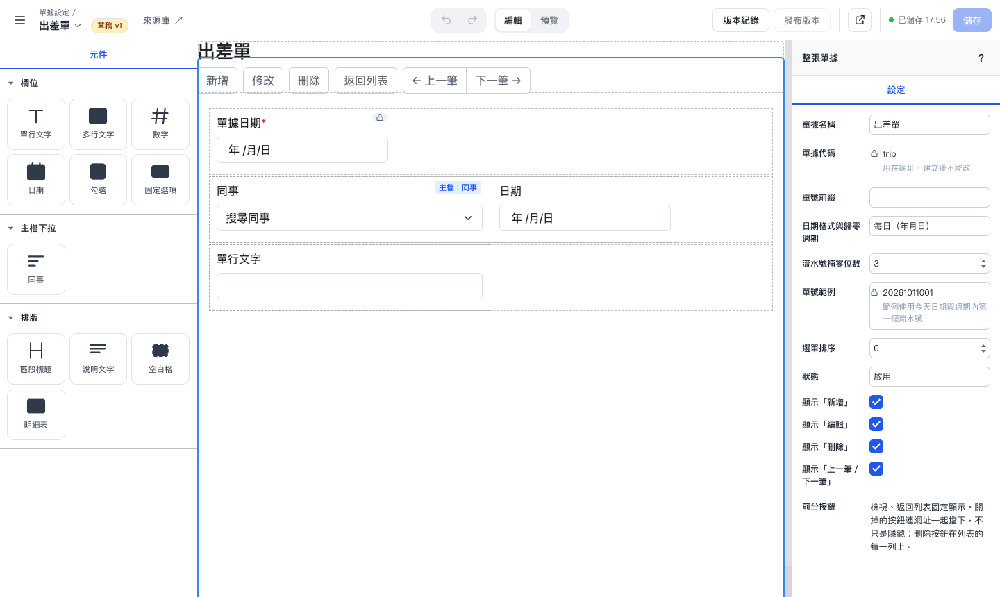

**填單**：使用者照設計好的表單填寫，主檔欄位可以搜尋

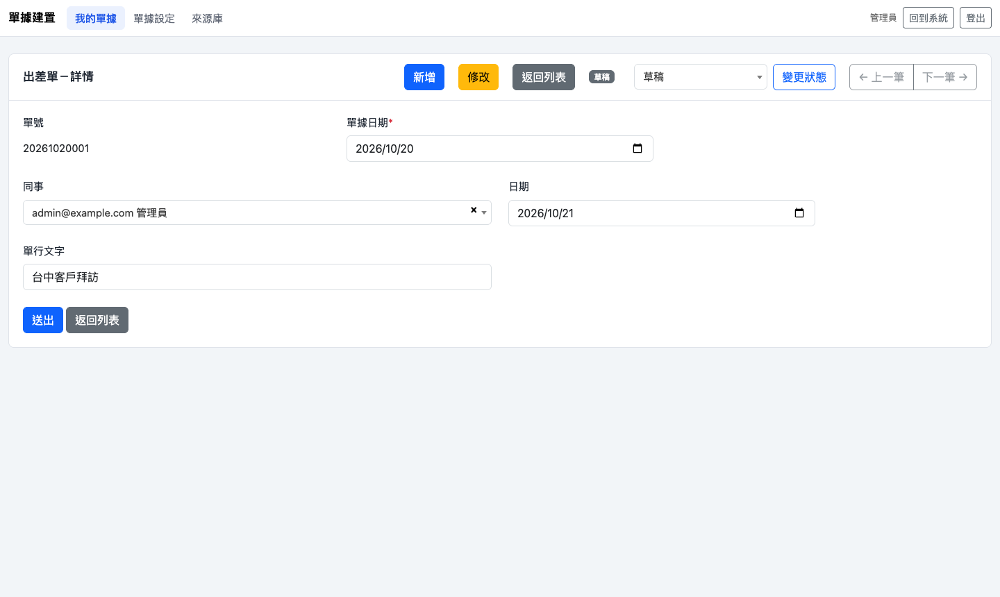

**來源庫**：管理員在畫面上設定主檔下拉的資料來源，可以先試搜尋

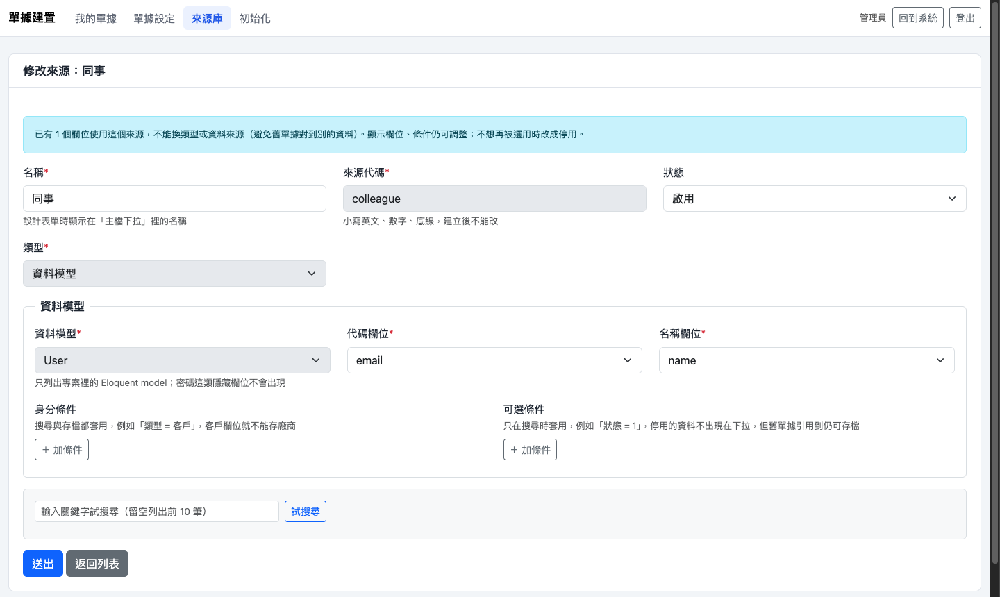

**安裝引導精靈**：`composer require` 之後全部在網頁上完成，不需要下任何指令（完整 5 步見[安裝](#安裝)）

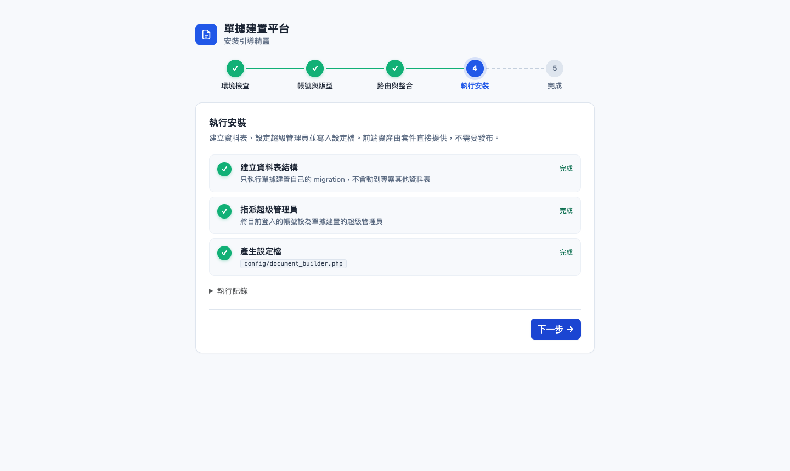

<details>
<summary>其他畫面</summary>

我的單據（首頁）

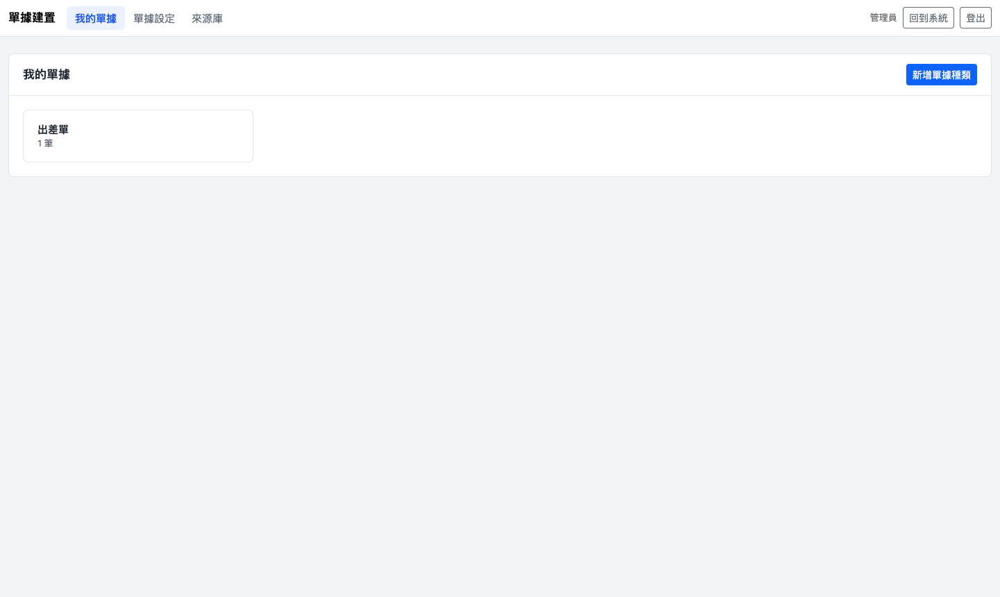

單據設定

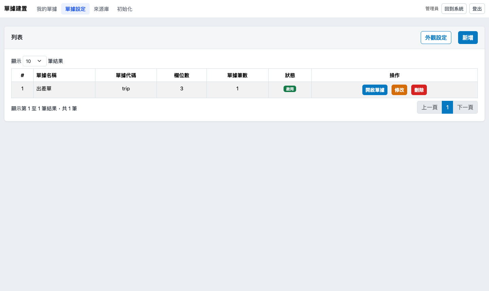

來源庫列表

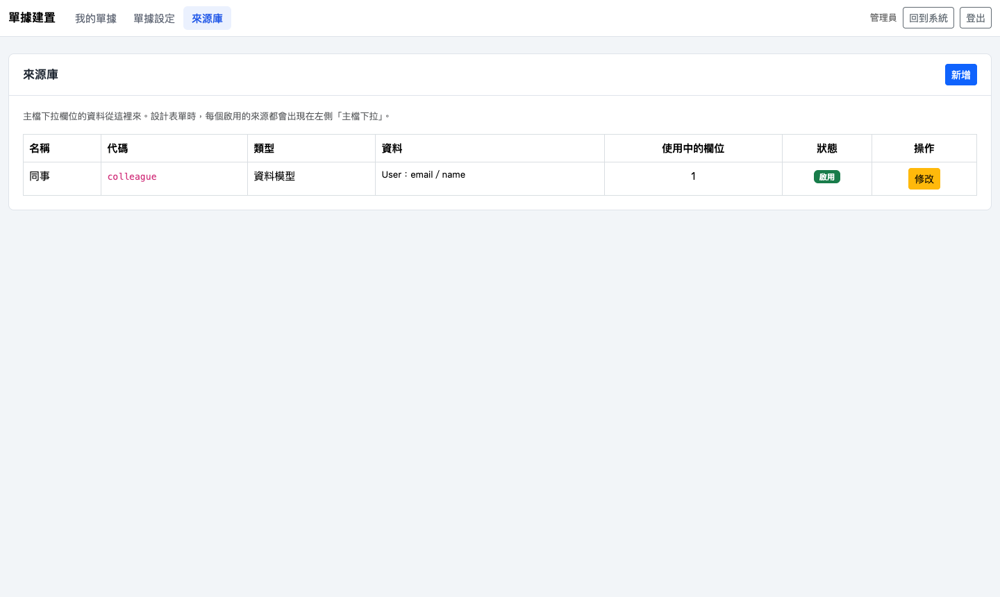

單據列表

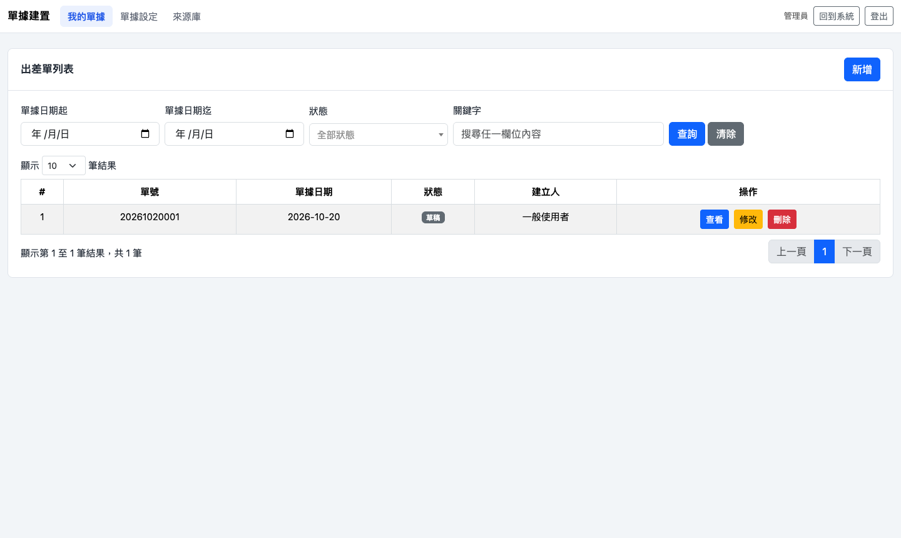

</details>

## 支援版本

| Laravel | PHP |
|---|---|
| 10 | 8.1 以上 |
| 11 | 8.2 以上 |
| 12 | 8.2 以上 |
| 13 | 8.3 以上 |

資料庫 MySQL、MariaDB、SQLite 都可以。使用者主鍵可以是自動遞增整數、UUID 或 ULID。
介面文字有繁體中文（`zh_TW`、`zh-Hant` 都可以）與英文，依 `app.locale` 切換。

實際驗證過的組合（全新專案＋Breeze 登入，從安裝、設計單據、建立來源到填單都在瀏覽器操作過；宿主也裝了繁中語系）：

| Laravel | PHP | 使用者主鍵 |
|---|---|---|
| 10 | 8.2 | 整數 |
| 11 | 8.2 | 整數 |
| 12 | 8.2 | UUID |
| 13 | 8.4 | ULID |

## 安裝

把套件加進專案後，其餘都在網頁上完成，不需要執行任何指令、不需要改程式：

```bash
composer require document-builder/document-builder
```

登入專案後打開 `/document_builder`，會自動進入**安裝引導精靈**：

1. **環境檢查**：PHP 版本與擴充、資料庫連線、storage 與 config 目錄是否可以寫入。
2. **帳號與版型**：自動偵測 guard、使用者 model、資料表、主鍵型別（int／UUID／ULID）與名稱欄位；選擇套件內建版型或嵌進專案的後台版型。
3. **路由與整合**：路由前綴（即時預覽網址）、名稱前綴、中介層；側選單整合會列出專案裡實作 `Integration` 的類別。
4. **執行安裝**：只執行單據建置自己的 migration、把你設為第一位超級管理員、寫入 `config/document_builder.php`，每一步顯示進度與執行記錄。
5. **完成**：一鍵匯入範本（樣品申請單）直接進設計器；管理超級管理員名單。

| 1. 環境檢查 | 2. 帳號與版型 |
|---|---|
| 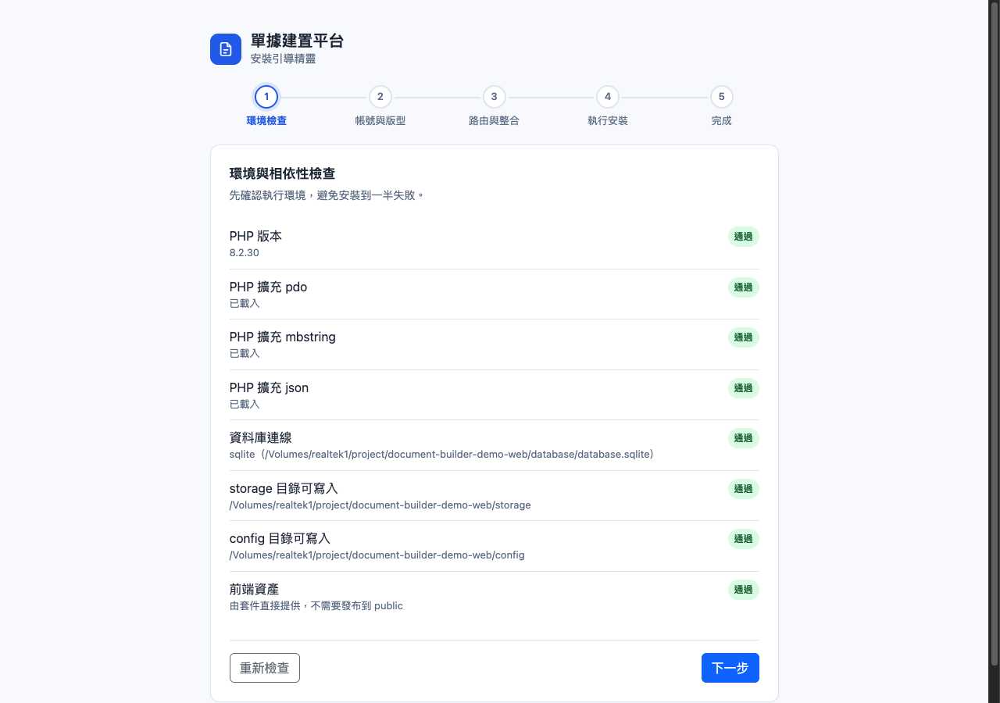 | 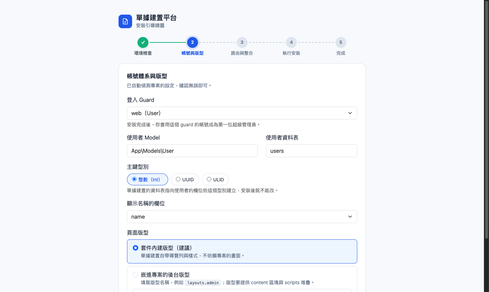 |
| **3. 路由與整合** | **4. 執行安裝** |
| 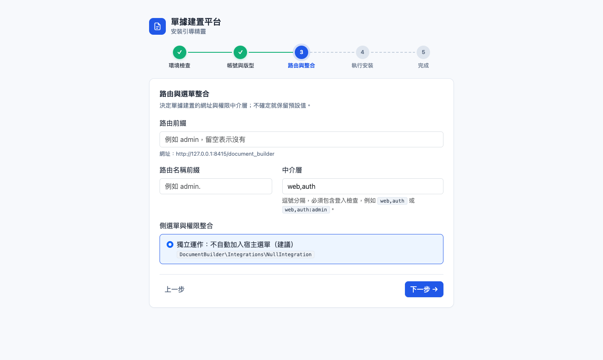 |  |
| **5. 完成** | |
| 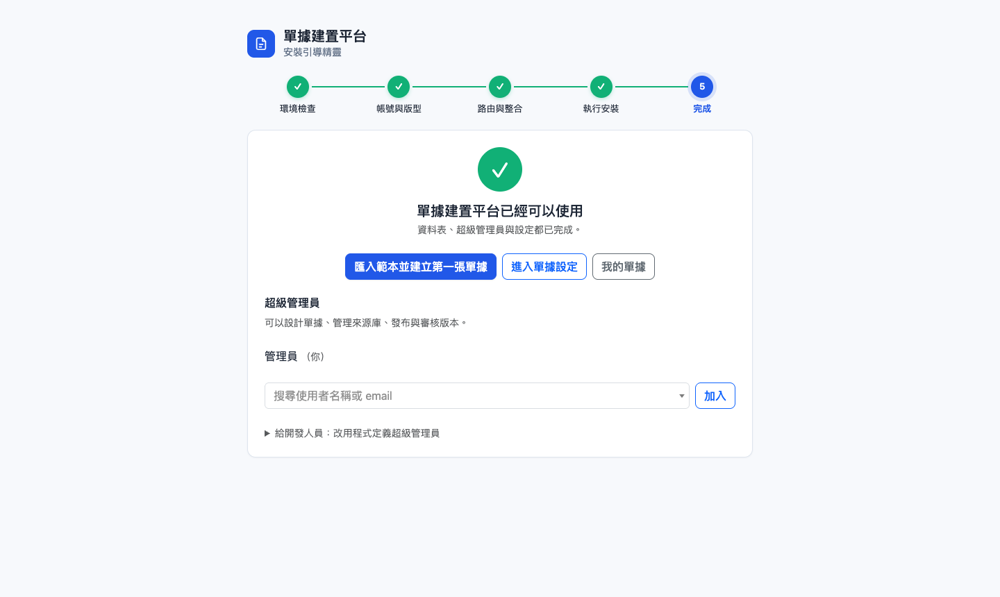 | |

**安全**：本機開發環境（`APP_ENV=local`）可以直接安裝；其他環境必須先在 `.env` 加上
`DOCUMENT_BUILDER_SETUP_TOKEN=自訂的一串密碼`，在精靈第一步輸入它，防止別人搶先安裝成為超級管理員。
安裝完成後，精靈只開放給超級管理員（一般使用者會看到 404）。

> 注意：`APP_ENV=local` 時精靈不需要 token。正式環境必須設成 `production`。設成 `local` 時，任何登入者都可以在安裝前搶先成為超級管理員。

其他說明：

- 前端資產由套件的路由直接提供，不需要發布到 `public/`。
- config 目錄無法寫入時，精靈會顯示設定檔內容，請開發人員自行存檔；資料表與超級管理員仍會完成。
- 設定檔不是必要的：沒有設定檔時，使用者相關設定一律自動偵測。

## 權限

| Gate | 用途 | 沒定義時 |
|---|---|---|
| `document-builder.super-admin` | 發布、審核、還原版本，透過 MCP 修改草稿 | 安裝精靈設定的超級管理員名單 |
| `document-builder.design` | 單據設定、設計器、版本紀錄、來源庫 | 等於 super-admin |
| `document-builder.view-type` | 參數是 `($user, DocType $type)`，誰能填寫、檢視某種單據 | 登入者都可以 |

超級管理員平常在安裝精靈的「完成」頁管理（加入、移除，至少留一位）。想改用專案自己的規則時，在 `AuthServiceProvider`
（Laravel 11 以後是 `AppServiceProvider`）定義 `document-builder.super-admin` Gate，就以程式為準。

要接自家後台的選單與權限，可以改實作 `DocumentBuilder\Contracts\Integration`，在精靈第 3 步選擇它。

## 來源庫

主檔下拉（例如客戶、產品、員工）的資料來源。管理員在「來源庫」頁面新增，不用改程式：

- **資料模型**：宿主專案的 Eloquent model。預設自動找出 `app/Models` 底下的 model；
  欄位排除 model 的 `$hidden` 與 `sources.hidden_columns`（密碼這類欄位碰不到）。
  可以設「身分條件」（搜尋與存檔都套用，例如客戶欄位不得存廠商）與「搜尋條件」（只在搜尋時套用，例如排除停用的資料）。
- **單據**：拿單據工廠自己建立的單據當來源，例如請假單引用「專案單」，不需要宿主有任何 model。

已經被欄位使用的來源不得換資料來源，也不得刪除，只可以停用；停用後，舊單據沿用原本的值仍可以存檔。
開發者也可以把來源寫在設定的 `masters`（不得在畫面上修改），和來源庫合併使用。
接其他資料（例如外部 API）時，實作 `DocumentBuilder\Contracts\SourceDriver` 後加進 `sources.drivers`。

## 設定（config/document_builder.php）

| 鍵 | 說明 |
|---|---|
| `route.prefix`／`route.name`／`route.middleware` | 套件路由的網址前綴、名稱前綴與中介層；中介層必須包含登入檢查 |
| `guard`／`user_model`／`users_table` | 登入者從哪個 guard 取得、用哪個 model、使用者資料表；null 表示自動偵測 |
| `user_key_type`／`user_name_column` | 使用者主鍵型別（int／uuid／ulid）與顯示名稱的欄位；null 表示自動偵測 |
| `setup.token`／`setup.open_environments` | 安裝精靈的 token（讀 `.env` 的 `DOCUMENT_BUILDER_SETUP_TOKEN`）與不需要 token 的環境（預設 `local`） |
| `theme.primary` | 按鈕主色（hex，例如 `#2563eb`）；null 為預設色（c11305-1 的藍）。hover、按下與文字色（深字或白字，依對比度）會自動算出 |
| `layout` | 頁面版型；預設是套件自帶的完整介面；嵌進自家後台時，改成自己的版型 |
| `ui.brand`／`ui.home_url`／`ui.logout_route` | 自帶介面左上角名稱、「回到系統」連結、登出路由 |
| `integration` | 宿主後台整合；預設 `NullIntegration`（不處理選單，檢視權限看 `view-type` Gate） |
| `assets.canvas_styles` | 設計器畫布的樣式；null 表示用套件自帶的 Bootstrap |
| `masters` | 程式定義的主檔來源（不得在畫面上修改） |
| `sources.drivers`／`sources.models`／`sources.hidden_columns` | 來源庫的驅動、資料模型可以選的 model（null 表示自動找）、不開放的欄位 |

這些設定都可以在安裝精靈裡調整。沒有寫在宿主設定檔裡的頂層鍵沿用套件預設值。`config/form_platform.php`（元件與欄位型別規格）一般不需要發布。

## 嵌進自家後台

把 `layout` 改成自己的版型。版型必須提供 `content` 區塊、`styles` 與 `scripts` 堆疊，並載入
Bootstrap 5、jQuery、jQuery Form、select2、SweetAlert2、DataTables，以及顯示 AJAX 錯誤的全域處理
（可以參考套件的 `resources/views/layouts/app.blade.php`）。`assets.canvas_styles` 填自家的樣式，
讓設計器畫布和填單畫面長得一樣。

## 主要路由（名稱前綴依 `route.name`）

- `document_builder.setup`：安裝引導精靈（安裝後只開放給超級管理員）
- `document_builder.home`：首頁，列出目前使用者能填寫的單據
- `document_builder.types.index`：單據設定
- `document_builder.designer.edit`：表單設計器
- `document_builder.sources.index`：來源庫
- `doc_records.index`：某種單據的填單列表（`{docType:code}`）
- `document_builder.mcp`：MCP HTTP 入口

## MCP

- HTTP：`document_builder.mcp` 路由，需要 `document-builder.design` 權限。非 localhost 的網址必須在 `FORM_PLATFORM_MCP_ALLOWED_HOSTS` 加入主機。
- stdio（只限 local 環境）：`php artisan form-platform:mcp-stdio --admin-id=<超級管理員主鍵>`

## 更新

```bash
composer update document-builder/document-builder
```

前端資產跟著套件更新，不需要重新發布。新版本有新的資料表時，打開單據建置的頁面會自動導向安裝精靈，
由超級管理員在「執行安裝」套用；這段期間一般使用者會看到「請超級管理員完成更新」。
部署流程原本就會執行 `php artisan migrate` 的專案，也會一併建立套件的資料表。

選用的發布內容：`vendor:publish --tag=document-builder-views`（視圖，發布到 `resources/views/vendor/document-builder`
後可以覆寫）、`--tag=document-builder-assets`（交給網頁伺服器提供靜態檔時）。按鈕文字可以在
`lang/vendor/document-builder/{locale}/ui.php` 覆寫。

> 注意：發布前端資產後，`public/` 裡的是複本。套件更新後必須重新執行 `vendor:publish --tag=document-builder-assets --force`，否則畫面停在舊版。不發布時，資產由套件路由提供，不會有這個問題。

宿主的驗證訊息與登入畫面改成中文時，可以安裝 [Laravel-Lang](https://laravel-lang.com)：
`composer require laravel-lang/common --dev`、`php artisan lang:add zh_TW`，再把 `app.locale` 設成 `zh_TW`。

## 開發

```bash
composer install
vendor/bin/phpunit                          # 目前安裝的 Laravel 版本
bin/test-all-versions.sh                    # Laravel 10、11、12、13 各跑一次
bin/test-all-versions.sh 11                 # 只跑 Laravel 13（參數是 testbench 主版本：8／9／10／11）
PHP_BIN=/path/to/php8.4 bin/test-all-versions.sh 11   # 指定 PHP
```

Laravel 13 必須用 PHP 8.3 以上；目前的 PHP 版本太舊時，腳本會標示「跳過」該版本，換 PHP 再跑一次。

測試用 orchestra/testbench 在乾淨的 Laravel 環境裡安裝套件，涵蓋自帶介面、權限、填單、UUID 使用者與來源庫。

## 授權

MIT，見 [LICENSE](LICENSE)。內附的第三方前端函式庫各自的授權檔在 `resources/dist/vendor/` 底下。
